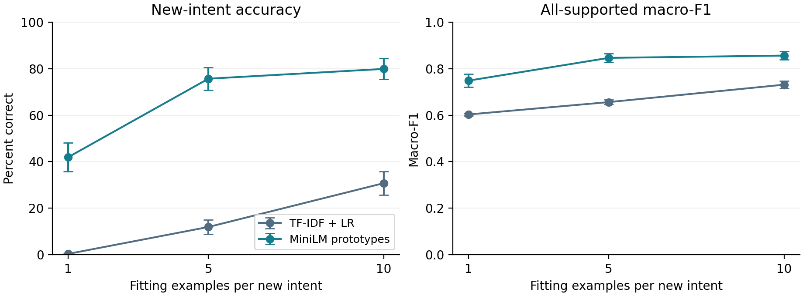
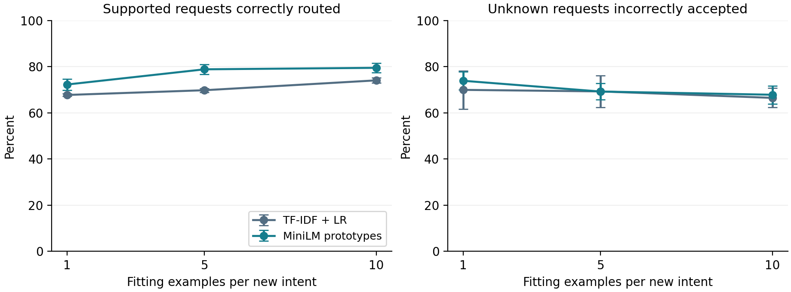

# Few-Shot Customer Support Routing with Unknown-Intent Detection

Aanshi Arora | IIT Kharagpur | Undergraduate benchmarking study | October 2026

## Abstract

This study compares TF-IDF/logistic regression with frozen MiniLM sentence embeddings and category prototypes when a banking-support system expands its intent inventory. BANKING77 categories are divided into 45 initially supported, 15 newly introduced, seven development-only unknown and ten final-test unknown intents. New categories receive 1, 5 or 10 fitting examples, with additional labelled development data for rejection-threshold calibration. Across three category splits and three adaptation samples, prototypes achieved mean new-intent accuracies of 41.94%, 75.70% and 79.91%, compared with 0.35%, 11.93% and 30.78% for unweighted logistic regression. At five shots, the gap is 63.78 percentage points. However, unknown false acceptance remained high for both methods. The results establish an adaptation advantage under this protocol, not a reliable production rejection system or a causal comparison of equally resourced representations.

## 1. Motivation and related work

Customer-support routing must distinguish between supported requests and unfamiliar needs. Adding a service changes the supported inventory while leaving other requests out of scope. Classification accuracy alone can obscure two costly failures: routing unfamiliar requests automatically and escalating requests that could have been handled correctly.

Casanueva et al. [1] introduced BANKING77 and investigated pretrained sentence encoders for low-data intent detection. Larson et al. [2] showed the importance of evaluating out-of-scope prediction separately from supported-intent classification. Snell et al. [3] provide the prototype-based few-shot learning principle. Here, prototypes are built on a frozen existing encoder; this is not a reproduction of their learned episodic representation or a proposed new algorithm.

## Research questions

RQ1. How does new-intent classification change with 1, 5 and 10 fitting examples?

RQ2. How does adding categories affect correct routing and rejection of still-unknown requests?

RQ3. What failure patterns are visible in a targeted qualitative audit?

The contribution is a reproducible controlled benchmark with matched samples, explicit calibration budgets, checked prediction provenance and analysis of adaptation versus rejection.

## 2. Dataset and experimental protocol

BANKING77 contains 10,003 training and 3,080 test messages across 77 labels; each official test category has 40 messages. Raw data and its CC BY 4.0 licence are retained. Lowercasing and whitespace collapse identify seven training rows that also occur in the official test set. These rows are excluded before any learning or development partition. Official test rows remain unchanged. Model input collapses whitespace; the encoder retains case, while TF-IDF lowercases.

Category-split seeds 0, 1 and 2 allocate 45 original, 15 new, seven development-unknown and ten test-unknown labels. Approximately 20% of duplicate-key groups in original/new training categories become development messages. Remaining original messages fit the original classifier. New-intent adaptation seeds 0, 1 and 2 draw distinct messages with nested prefixes of 1, 5 and 10 examples. Other new-intent training messages are unused. Final-test unknown categories never enter fitting or calibration.

Before addition, both new and final-test unknown intents are unsupported and reported separately. After addition, 60 intents are supported. Each evaluation has 1,800 original, 600 new and 400 final-test unknown messages. Post-adaptation development sets contain 1,546, 1,554 and 1,573 messages across the three splits, including 443, 390 and 349 labelled new-intent messages. Thus k-shot describes fitting data, not the complete labelled-data budget.

## 3. Models and rejection

TF-IDF uses word unigrams/bigrams, sublinear term frequency and min_df=1. Multiclass logistic regression uses C=10, lbfgs and max_iter=1000 without class weighting. On addition, vocabulary and classifier are refitted on original training messages plus new examples. Settings are fixed; they are not tuned against final test outcomes.

MiniLM uses sentence-transformers/all-MiniLM-L6-v2, revision 1110a243fdf4706b3f48f1d95db1a4f5529b4d41. Independent frozen inference creates 384-dimensional L2-normalized vectors. A category prototype is the mean of its fitting vectors, normalized again. Prediction selects the largest cosine similarity. Adding categories preserves original prototypes. No encoder training is performed; no messages were truncated at the 256-token limit.

The acceptance score is maximum LR probability or maximum prototype cosine. The threshold is the lower 10th percentile of supported-development scores; accept if score >= threshold. Before addition, calibration uses original dev messages. After addition, it uses original plus new dev messages. Development unknown outcomes are diagnostics only. Neither score is assumed to be calibrated confidence.

## Metrics and aggregation

New accuracy ignores rejection; correct routing counts only accepted correct predictions. Unknown false acceptance is the accepted fraction of final-test unknown messages. Per-category F1 uses all currently supported messages, including cross-group false positives. Each method has 27 post configurations and three pre baselines. Sampling seeds are averaged within each category split; three split means are equally weighted. Error bars show descriptive SD across split means, not independent-dataset confidence intervals.

## 4. Adaptation results

| Model | Shots | New accuracy (%) | F1 | Correct routing (%) | Unknown accepted (%) |
|---|---:|---:|---:|---:|---:|
| TF-IDF + LR | 1 | 0.35 | 0.603 | 67.76 | 69.97 |
| TF-IDF + LR | 5 | 11.93 | 0.656 | 69.82 | 69.31 |
| TF-IDF + LR | 10 | 30.78 | 0.731 | 74.09 | 66.50 |
| MiniLM prototypes | 1 | 41.94 | 0.749 | 72.30 | 73.92 |
| MiniLM prototypes | 5 | 75.70 | 0.847 | 78.88 | 69.25 |
| MiniLM prototypes | 10 | 79.91 | 0.856 | 79.53 | 67.86 |

Table 1. Means across the repeated design. New accuracy, correct routing and unknown false acceptance are percentages. F1 is on the 0-1 scale. Additional labelled development data is used in every post-adaptation setting.

Figure 1. New-intent accuracy and all-supported macro-F1. Error bars are SD across three category-split means after averaging adaptation samples within each split. The overlapping splits are not independent datasets.

Prototype accuracy rises substantially from one to five fitting examples, then more modestly from five to ten. The unweighted LR baseline also improves with additional examples but remains much weaker on new intents. At ten shots, prototypes reach 79.91% mean new accuracy and 0.856 all-supported F1; LR reaches 30.78% and 0.731.

This contrast is compatible with a benefit from pretrained semantic representations, but it does not isolate that cause. LR faces severe imbalance between many original examples and few new ones, and the prototype classifier allocates one representative vector per category. Class balancing and a classifier trained on the same embeddings would be useful future ablations. They were not executed in this study.

The comparison therefore concerns these two practical pipelines under matched adaptation samples and fixed configurations. It does not establish that all linear models fail at few-shot learning, or that prototypes universally outperform fine-tuning.

## 5. Routing reliability and qualitative findings

Figure 2. Accepted correct routing on supported messages versus false acceptance of unknown messages. Lower is better only in the right panel. These are different populations and should not be combined without an explicit deployment mixture or cost model.

At five shots, prototypes correctly route 78.88% of supported requests versus 69.82% for LR. Yet unknown false acceptance is 69.25% versus 69.31%. At ten shots, LR has slightly lower unknown false acceptance (66.50% versus 67.86%) despite weaker adaptation. Neither model provides reliable unknown rejection at the chosen high-coverage operating point.

Supported test acceptance stays near the 90% development target: approximately 89.9-90.8% for LR and 89.5-90.1% for prototypes across shot counts. This does not imply an unknown-error guarantee. Comparisons are at a shared calibration target, not exactly matched test coverage. Selecting a stricter threshold based on test results would invalidate the primary evaluation.

## AI-assisted qualitative audit

Forty-two model-message cases (42 distinct messages) were inspected from split 0, adaptation seed 0, five-shot outputs. Per model, six cases were sampled for original misroutes, new misroutes and accepted unknowns, plus three supported rejections. Sampling seeds were fixed at 42 and 17. This selected sample illustrates failure mechanisms; its category proportions do not estimate their prevalence. Interpretations are AI-assisted and not independently adjudicated.

Semantically adjacent labels create difficult boundaries. For example, an unknown failed-transfer request was accepted as declined_transfer by prototypes; an unknown transfer-fee request was accepted as a supported bank-transfer top-up fee. A prototype prediction for "Are there limits on auto top-up?" selected top_up_limits rather than automatic_top_up. These messages can combine multiple cues even when the benchmark assigns one intent.

Some rejections discard correct top-one predictions. Prototype cases about a forgotten access code and an extra pound charged were correctly classified but rejected by the global threshold. Conversely, LR routed a card-arrival request to lost_or_stolen_phone. The audit suggests both fine-grained boundary ambiguity and score/rejection failures; it does not establish causal explanations or justify relabelling data. All 42 case notes are supplied separately.

## 6. Limitations and reproducibility

Calibration budget: labelled new-intent development messages exceed the 1/5/10 fitting examples. No strict k-shot end-to-end claim is made. Representation resources: MiniLM benefits from external pretraining; pretraining overlap with BANKING77 was not audited. Baseline imbalance: unweighted LR is a fixed baseline, not a tuned or class-balanced competitor.

Generalization: category holdouts are artificial, the benchmark is English banking text, and only three overlapping category splits are used. No other domain or real deployment is evaluated. Rare labels, genuinely new services and real user traffic may behave differently. Rejection: the global threshold targets supported coverage rather than optimizing unknown-error cost. Both methods fail frequently on held-out unknowns.

Environment: two verified post-adaptation pilot outputs and two pre phases were reused. The LR pilot records scikit-learn 1.9.1; newly executed Stage 5 LR runs use 1.8.0. Per-run provenance documents this mixed environment; it is not an exact single-environment replication. Prototype update timing excludes cached encoder inference, so no end-to-end latency superiority is claimed.

All 60 saved phases were verified against split identities, file checksums, permitted labels, test rows and calibration scores. Core metrics were independently recomputed for all 54 post configurations. Each checkpoint retains predictions, development scores and metadata. Embeddings are cached with model revision, data hashes and preprocessing identity. Analysis introduces no new fitting or test-driven threshold changes.

## 7. Conclusion

Frozen MiniLM prototypes provide substantially stronger new-intent recognition than the fixed unweighted TF-IDF/LR pipeline under this benchmark protocol. That advantage does not solve open-set routing: unknown false acceptance remains high. The defensible outcome is a measured adaptation-versus-rejection trade-off and a reproducible baseline study. Future work should isolate class imbalance and representation effects and evaluate development-chosen rejection operating points under stricter label budgets.

## References

[1] Casanueva, I., et al. (2020). Efficient Intent Detection with Dual Sentence Encoders. NLP4ConvAI, pp. 38-45. https://aclanthology.org/2020.nlp4convai-1.5/

[2] Larson, S., et al. (2019). An Evaluation Dataset for Intent Classification and Out-of-Scope Prediction. EMNLP-IJCNLP. https://aclanthology.org/D19-1131/

[3] Snell, J., Swersky, K., and Zemel, R. (2017). Prototypical Networks for Few-shot Learning. NeurIPS. https://arxiv.org/abs/1703.05175

[4] Sentence Transformers. all-MiniLM-L6-v2 model card, pinned revision above. https://huggingface.co/sentence-transformers/all-MiniLM-L6-v2
